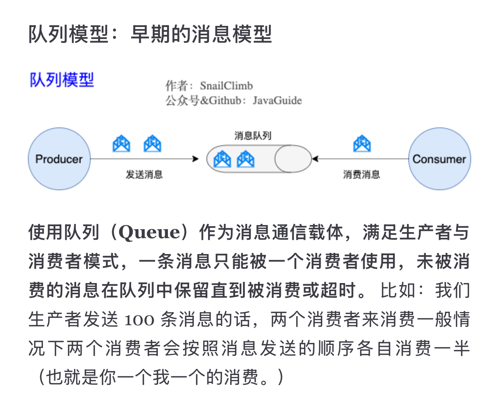
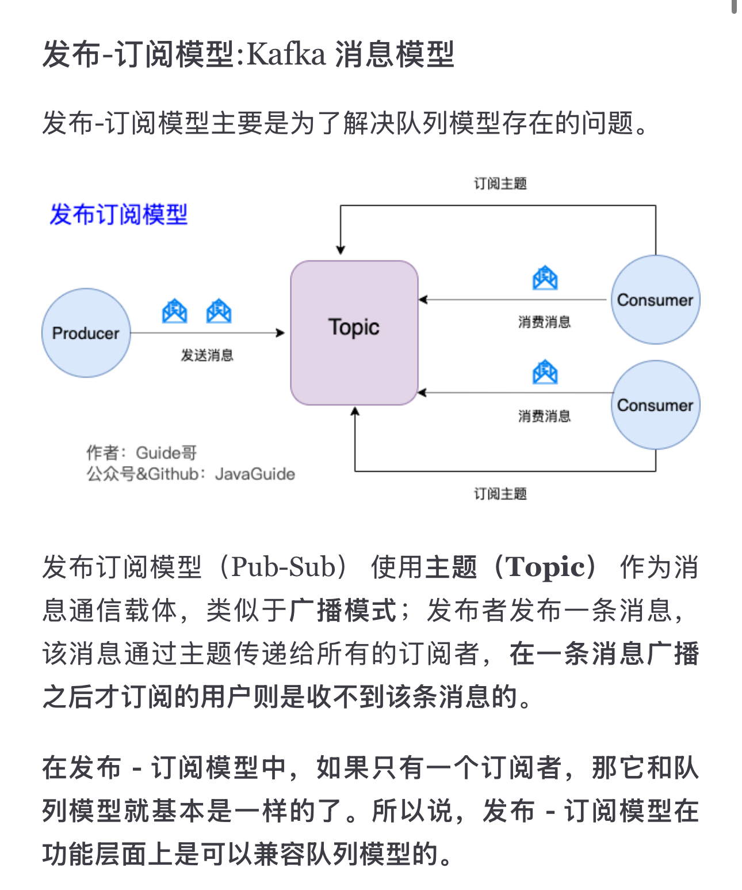

# Kafka

[https://javaguide.cn/high-performance/message-queue/kafka-questions-01.html#和其他消息队列相比-kafka-的优势在哪里](https://javaguide.cn/high-performance/message-queue/kafka-questions-01.html#%E5%92%8C%E5%85%B6%E4%BB%96%E6%B6%88%E6%81%AF%E9%98%9F%E5%88%97%E7%9B%B8%E6%AF%94-kafka-%E7%9A%84%E4%BC%98%E5%8A%BF%E5%9C%A8%E5%93%AA%E9%87%8C)

两种工作模式：

