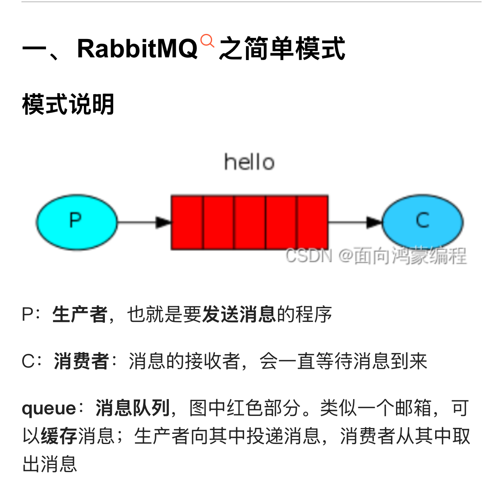
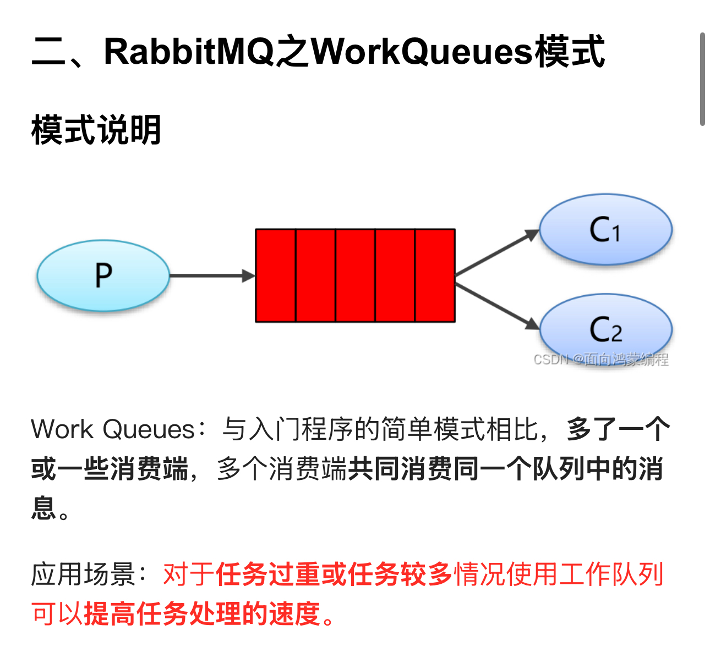
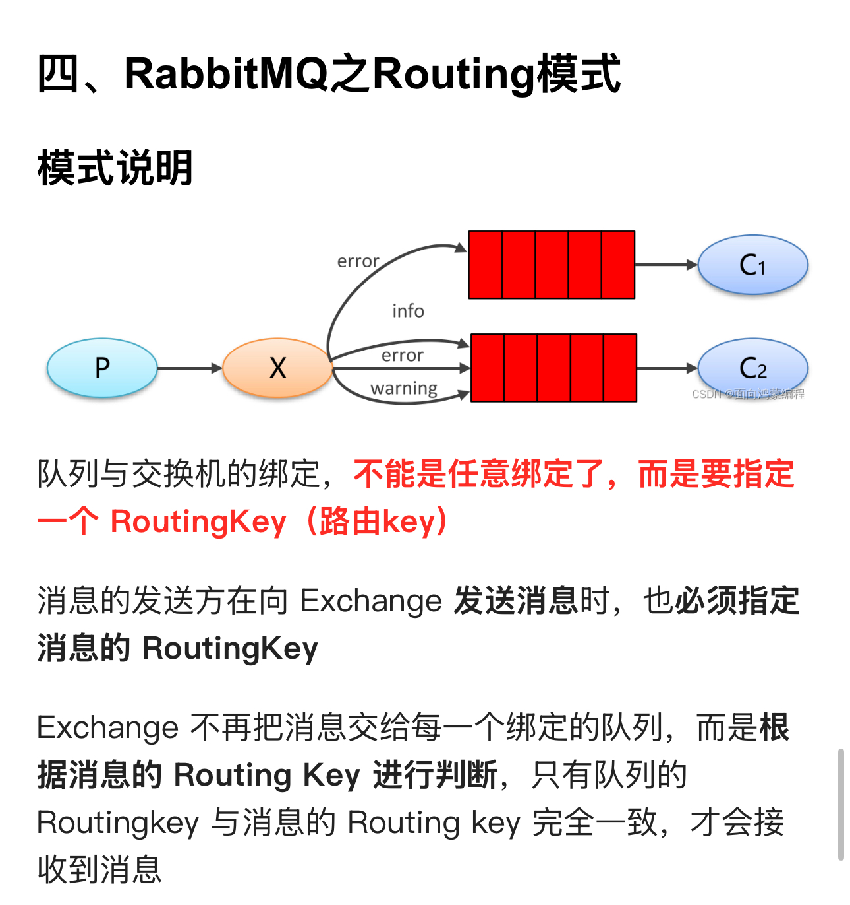

# rabbitmq

[https://javaguide.cn/high-performance/message-queue/rabbitmq-questions.html#什么是优先级队列](https://javaguide.cn/high-performance/message-queue/rabbitmq-questions.html#%E4%BB%80%E4%B9%88%E6%98%AF%E4%BC%98%E5%85%88%E7%BA%A7%E9%98%9F%E5%88%97)

# 5种工作模式

