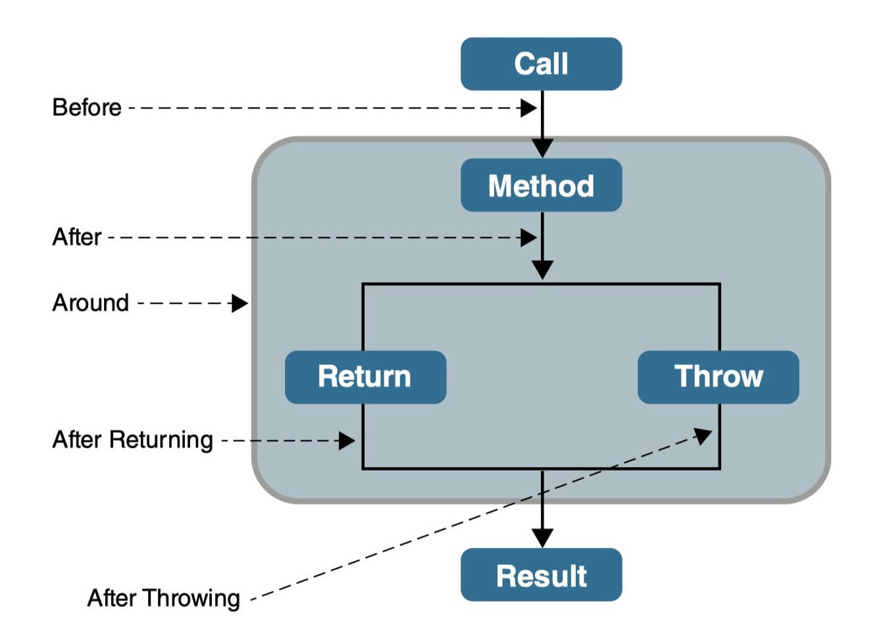

# SpringAOP

# 1. 什么是AOP？

AOP（Aspect Oriented Programming）即面向切面编程，AOP 是 OOP（面向对象编程）的一种延续，二者互补，并不对立。

AOP 的目的是将横切关注点（如日志记录、事务管理、权限控制、接口限流、接口幂等等）从核心业务逻辑中分离出来，通过动态代理、字节码操作等技术，实现代码的复用和解耦，提高代码的可维护性和可扩展性。OOP 的目的是将业务逻辑按照对象的属性和行为进行封装，通过类、对象、继承、多态等概念，实现代码的模块化和层次化（也能实现代码的复用），提高代码的可读性和可维护性。

# 2. AOP解决了什么问题？

OOP 不能很好地处理一些分散在多个类或对象中的公共行为（如日志记录、事务管理、权限控制、接口限流、接口幂等等），这些行为通常被称为 **横切关注点（cross-cutting concerns）** 。如果我们在每个类或对象中都重复实现这些行为，那么会导致代码的冗余、复杂和难以维护。

AOP 可以将横切关注点（如日志记录、事务管理、权限控制、接口限流、接口幂等等）从 **核心业务逻辑（core concerns，核心关注点）** 中分离出来，实现关注点的分离。

# 3. AOP的核心概念

这里顺带总结一下 AOP 关键术语（不理解也没关系，可以继续往下看）：

- **横切关注点（cross-cutting concerns）** ：多个类或对象中的公共行为（如日志记录、事务管理、权限控制、接口限流、接口幂等等）。
- **切面（Aspect）**：对横切关注点进行封装的类，一个切面是一个类。切面可以定义多个通知，用来实现具体的功能
- **连接点（JoinPoint）**：连接点是方法调用或者方法执行时的某个特定时刻（如方法调用、异常抛出等）。
- **通知（Advice）**：通知就是切面在某个连接点要执行的操作。通知有五种类型，分别是前置通知（Before）、后置通知（After）、返回通知（AfterReturning）、异常通知（AfterThrowing）和环绕通知（Around）。前四种通知都是在目标方法的前后执行，而环绕通知可以控制目标方法的执行过程。
- **切点（Pointcut）**：一个切点是一个表达式，它用来匹配哪些连接点需要被切面所增强。切点可以通过注解、正则表达式、逻辑运算等方式来定义。比如 `execution(* com.xyz.service..*(..))`匹配 `com.xyz.service` 包及其子包下的类或接口。
- **织入（Weaving）**：织入是将切面和目标对象连接起来的过程，也就是将通知应用到切点匹配的连接点上。常见的织入时机有两种，分别是编译期织入（Compile-Time Weaving 如：AspectJ）和运行期织入（Runtime Weaving 如：AspectJ、Spring AOP）。

| 术语 | 代码中具体位置 | 通俗解释 |
| --- | --- | --- |
| 目标对象（Target） | `UserService` 类的原始实例（未被 AOP 增强的业务对象） | 被 “增强” 的那个原始业务类（比如真正处理用户添加 / 删除的类） |
| 连接点（Joinpoint） | `UserService` 中的 `addUser()`、`deleteUser()` 方法（所有可被 AOP 拦截的方法） | AOP 能 “切到” 的所有方法（候选对象） |
| 切入点（Pointcut） | `@Pointcut("execution(* com.example.demo.service.UserService.*(..))")` 注解 + 对应的方法 | 从所有连接点中 “筛选出要拦截的方法”（比如只拦截 UserService 的所有方法） |
| 切面（Aspect） | `LogAspect` 类（标注了 `@Aspect`） | 把 “切入点（切哪里）” 和 “通知（切了做什么）” 封装在一起的类（核心 AOP 类） |
| 通知（Advice） | `@Before`/`@After`/`@Around` 注解修饰的方法（`beforeAdvice()`/`afterAdvice()`/`aroundAdvice()`） | 拦截到方法后要执行的逻辑（比如日志记录、权限校验） |
| 代理对象（Proxy） | 测试类中 `@Autowired` 注入的 `UserService` 实例（Spring 动态生成） | Spring 替你创建的 “包装类”，调用它的方法会先执行通知，再执行原始方法 |
| 织入（Weaving） | 无具体代码行，是 Spring 运行时将 “切面” 应用到 “目标对象” 生成 “代理对象” 的过程 | 把 AOP 逻辑（日志）“织” 进业务逻辑（添加用户）的动作（Spring 自动完成） |

# 4. AOP常见通知类型



---

- **Before**（前置通知）：目标对象的方法调用之前触发
- **After** （后置通知）：目标对象的方法调用之后触发
- **AfterReturning**（返回通知）：目标对象的方法调用完成，在返回结果值之后触发
- **AfterThrowing**（异常通知）：目标对象的方法运行中抛出 / 触发异常后触发。AfterReturning 和 AfterThrowing 两者互斥。如果方法调用成功无异常，则会有返回值；如果方法抛出了异常，则不会有返回值。
- **Around** （环绕通知）：编程式控制目标对象的方法调用。环绕通知是所有通知类型中可操作范围最大的一种，因为它可以直接拿到目标对象，以及要执行的方法，所以环绕通知可以任意的在目标对象的方法调用前后搞事，甚至不调用目标对象的方法

# 5. AOP实现原理

AOP的实现依赖于动态代理或字节码操作技术。以下是两种主要的实现方式：

### **(1) 动态代理（Dynamic Proxy）**

动态代理是AOP最常用的实现方式。它通过在运行时创建代理对象，拦截目标对象的方法调用，并在调用前后插入额外的逻辑（如日志记录或事务管理）。默认使用Java动态代理，如果类没有继承接口则使用CGLIB

- **Java动态代理**：使用`java.lang.reflect.Proxy`和`InvocationHandler`。
- **CGLIB代理**：使用CGLIB库生成目标类的子类，适用于代理非接口类。

```jsx
import java.lang.reflect.InvocationHandler;
import java.lang.reflect.Method;
import java.lang.reflect.Proxy;

public class LoggingProxy implements InvocationHandler {
    private final Object target;

    public LoggingProxy(Object target) {
        this.target = target;
    }

    @Override
    public Object invoke(Object proxy, Method method, Object[] args) throws Throwable {
        System.out.println("Before method: " + method.getName());
        Object result = method.invoke(target, args); // 调用目标方法
        System.out.println("After method: " + method.getName());
        return result;
    }

    public static <T> T createProxy(T target, Class<T> interfaceType) {
        return (T) Proxy.newProxyInstance(
                interfaceType.getClassLoader(),
                new Class<?>[]{interfaceType},
                new LoggingProxy(target)
        );
    }
}
```

### **(2) 字节码操作（Bytecode Manipulation）**

字节码操作通过直接修改目标类的字节码来实现AOP。这种方式通常使用工具（如ASM、Javassist或CGLIB）来操作字节码。它比动态代理更灵活，但实现更复杂。

**示例：**
CGLIB通过生成目标类的子类来实现代理，可以在不依赖接口的情况下实现AOP。

# 6. AOP 应用场景有哪些

- 日志记录：自定义日志记录注解，利用 AOP，一行代码即可实现日志记录。
- 性能统计：利用 AOP 在目标方法的执行前后统计方法的执行时间，方便优化和分析。
- 事务管理：`@Transactional` 注解可以让 Spring 为我们进行事务管理比如回滚异常操作，免去了重复的事务管理逻辑。`@Transactional`注解就是基于 AOP 实现的。
- 权限控制：利用 AOP 在目标方法执行前判断用户是否具备所需要的权限，如果具备，就执行目标方法，否则就不执行。例如，SpringSecurity 利用`@PreAuthorize` 注解一行代码即可自定义权限校验。
- 接口限流：利用 AOP 在目标方法执行前通过具体的限流算法和实现对请求进行限流处理。
- 缓存管理：利用 AOP 在目标方法执行前后进行缓存的读取和更新。

---

# 7. Java动态代理和CGLIB区别

CGLIB（Code Generation Library）和Java动态代理（Java Dynamic Proxy）都是实现动态代理的技术，但它们在实现原理、适用场景和功能特性上存在显著区别。以下是两者的详细对比：

---

### **1. 实现原理**

### **(1) Java动态代理**

- **基于`java.lang.reflect.Proxy`类和`InvocationHandler`接口**：
    - Java动态代理通过`Proxy`类生成代理对象，代理对象实现了目标类的接口。
    - 代理对象的所有方法调用都会被转发到`InvocationHandler`的`invoke()`方法中，从而实现方法的拦截和增强。
- **依赖接口**：
    - 目标类必须实现一个接口，代理对象通过实现该接口来代理目标类的方法。
    - 如果目标类没有实现接口，则无法使用Java动态代理。

### **(2) CGLIB**

- **基于字节码操作**：
    - CGLIB通过字节码操作库（如ASM）动态生成目标类的子类，代理对象继承目标类。
    - 代理对象重写目标类的方法，并在方法调用前后插入额外的逻辑。
- **无需接口**：
    - CGLIB不依赖接口，可以直接代理没有实现接口的类。

---

### **2. 适用场景**

### **(1) Java动态代理**

- **适用场景**：
    - 目标类实现了接口，且需要通过接口进行代理。
    - 适合轻量级的代理场景，因为基于反射的实现相对简单。
- **限制**：
    - **必须实现接口**：如果目标类没有实现接口，则无法使用Java动态代理。
    - **性能开销**：反射调用有一定的性能开销，尤其是在高并发场景下。

### **(2) CGLIB**

- **适用场景**：
    - 目标类没有实现接口，或者需要直接代理类本身。
    - 适合需要高性能代理的场景，因为CGLIB生成的代理类是直接继承目标类的。
- **限制**：
    - **不能代理`final`类或`final`方法**：因为CGLIB通过生成子类实现代理，而`final`类或方法不能被继承或重写。
    - **字节码操作复杂**：CGLIB的实现依赖于字节码操作，因此比Java动态代理更复杂，且可能引入更多的字节码操作开销。

---

### **3. 性能对比**

### **(1) Java动态代理**

- **性能开销**：
    - 基于反射调用，每次方法调用都会涉及反射的开销。
    - 在高并发场景下，性能开销可能较为明显。
- **优点**：
    - 实现简单，易于理解和使用。
    - 适合轻量级的代理场景。

### **(2) CGLIB**

- **性能优势**：
    - 生成的代理类是目标类的子类，方法调用直接通过继承实现，性能更高。
    - 在高并发场景下，性能表现更好。
- **缺点**：
    - 字节码操作引入了一定的初始化开销，但在运行时性能更高。
    - 生成的代理类可能比目标类更大，占用更多内存。

---

### **5. 总结**

| 特性 | Java动态代理 | CGLIB |
| --- | --- | --- |
| 实现原理 | 基于`java.lang.reflect.Proxy`和`InvocationHandler` | 基于字节码操作（ASM） |
| 是否依赖接口 | 是，必须实现接口 | 否，直接代理类本身 |
| 性能 | 反射调用有开销，适合轻量级场景 | 性能更高，适合高性能场景 |
| 适用场景 | 目标类实现接口的场景 | 目标类未实现接口或需要高性能的场景 |
| 限制 | 不能代理未实现接口的类 | 不能代理`final`类或`final`方法 |
| 使用复杂度 | 简单，易于理解 | 较复杂，依赖字节码操作 |

---

### **6. Spring中的选择机制**

在Spring框架中，代理机制的选择是自动化的：

- 如果目标类实现了接口，默认使用**Java动态代理**。
- 如果目标类没有实现接口，或者配置了`proxy-target-class=true`，则使用**CGLIB代理**。

这种机制结合了两者的优点，既保证了简单性，又提供了高性能的选项。

# 8. AspectJ

> Spring AOP 已经集成了 AspectJ ，AspectJ 应该算的上是 Java 生态系统中最完整的 AOP 框架了。
> 
> 
> **Spring AOP 属于运行时增强，而 AspectJ 是编译时增强。** Spring AOP 基于代理(Proxying)，而 AspectJ 基于字节码操作(Bytecode Manipulation)。
> 
> Spring AOP 已经集成了 AspectJ ，AspectJ 应该算的上是 Java 生态系统中最完整的 AOP 框架了。AspectJ 相比于 Spring AOP 功能更加强大，但是 Spring AOP 相对来说更简单，
> 
> 如果我们的切面比较少，那么两者性能差异不大。但是，当切面太多的话，最好选择 AspectJ ，它比 Spring AOP 快很多。
> 
> ---
> 

Spring AOP和AspectJ AOP都是实现面向切面编程（AOP）的技术，但它们在实现机制、功能、适用场景等方面存在显著区别。以下是两者的详细对比：

### **1. 实现机制**

- **Spring AOP**
    - **基于动态代理**：Spring AOP通过动态代理技术实现切面逻辑的织入。对于实现了接口的类，使用JDK动态代理；对于没有实现接口的类，使用CGLIB代理。
    - **运行时织入**：切面逻辑在运行时被织入到目标对象中。
    - **连接点限制**：仅支持方法级别的连接点，即只能在方法调用前后插入切面逻辑。
- **AspectJ AOP**
    - **编译时织入**：AspectJ通过编译器（如`ajc`）在编译时将切面逻辑织入目标类的字节码中。
    - **加载时织入**：也可以在类加载时通过加载时织入（Load-Time Weaving, LTW）来织入切面。
    - **丰富的连接点**：支持更广泛的连接点，包括方法调用、字段访问、构造函数调用、异常处理等。

### **2. 功能和灵活性**

- **Spring AOP**
    - **简单易用**：适合大多数基于Spring框架的应用场景，与Spring IoC容器紧密集成。
    - **依赖Spring容器**：必须在Spring上下文中运行。
    - **通知类型**：支持前置通知、后置通知、环绕通知、异常通知等。
- **AspectJ AOP**
    - **功能强大**：支持更复杂的切面类型，如引入新方法和字段，支持字段访问、构造函数调用等。
    - **独立性**：不依赖于任何特定框架，可以独立于Spring使用。
    - **细粒度控制**：提供更细粒度的切点表达式语言，可以精确地选择需要织入的连接点。

### **3. 性能**

- **Spring AOP**
    - **运行时开销**：由于基于动态代理，每次方法调用都会涉及额外的代理对象，可能会影响性能。
    - **内存占用**：动态代理对象会增加内存占用。
- **AspectJ AOP**
    - **编译时优化**：编译时织入可以减少运行时开销，提高性能。
    - **字节码修改**：直接修改字节码，减少了运行时的开销。

### **4. 使用场景**

- **Spring AOP**
    - **适合场景**：适合大多数基于Spring框架的应用，尤其是需要与Spring IoC容器集成的场景。
    - **配置方式**：可以通过注解（如`@Aspect`、`@Before`等）或XML配置。
- **AspectJ AOP**
    - **适合场景**：适用于需要更复杂切面逻辑、需要独立于Spring框架或需要在编译时优化性能的场景。
    - **配置方式**：可以通过注解、XML配置或编译时织入。

### **5. 总结**

- **Spring AOP**：基于动态代理，运行时织入，适合大多数Spring应用场景，简单易用。
- **AspectJ AOP**：编译时或加载时织入，支持更广泛的连接点和切面类型，功能强大但复杂度较高。

选择哪种AOP实现方式取决于具体的应用需求。如果项目已经使用Spring框架，推荐使用Spring AOP；如果需要更复杂的切面逻辑或更高的性能优化，可以考虑使用AspectJ。